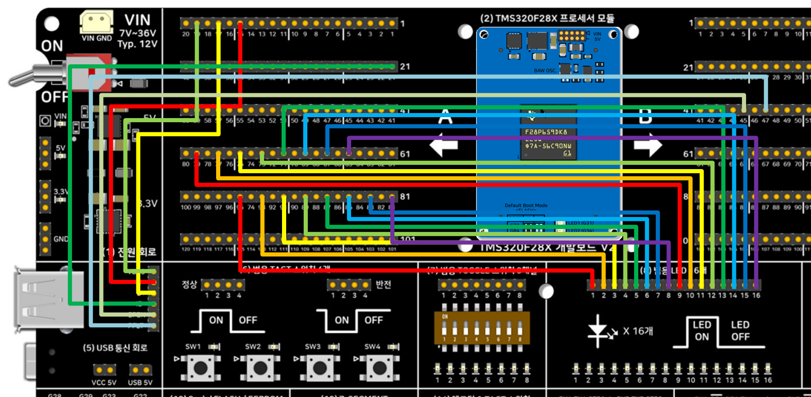

# USB 호스트 마우스 → LED16 좌우 이동 테스트 — 비트필드(레지스터 직접 제어) 버전 — TMS320F28P659DK8-Q1

[5_USB_HostMouse_Driverlib](../5_USB_HostMouse_Driverlib/README.md)(DriverLib 버전)와
동일한 동작을 애플리케이션 코드는 **DriverLib을 전혀 호출하지 않고** TI의 클래식
레지스터 비트필드 구조체(`GpioCtrlRegs`, `GpioDataRegs`, `ClkCfgRegs`)만으로 구현했습니다.

## 이 버전의 핵심 — 그리고 "완전히 DriverLib-free"는 아닌 이유
- 시스템 초기화: `InitSysCtrl()`/`InitGpio()`/`InitPieCtrl()`/`InitPieVectTable()`
  (DriverLib의 `Device_init()` 등에 대응하는 클래식 헬퍼)
- USB 핀 활성화: `GpioCtrlRegs.GPBAMSEL.bit.GPIO42/43`(아날로그 모드), `GPBDIR.bit.GPIO46/47`
  (입력) — DriverLib 버전의 `USBGPIOEnable()`과 동일한 레지스터 값을 만듭니다.
- USB 60MHz 클럭: `initUsbAuxClock()`이 `ClkCfgRegs.AUXPLLCTL1/AUXPLLMULT/AUXPLLSTS`를
  직접 조작해 DriverLib의 `SysCtl_setAuxClock(DEVICE_AUXSETCLOCK_CONFIG_USB)`와 동일한
  120MHz(→60MHz) AUXPLLCLK를 만듭니다(DCC 주파수 검증/재시도 로직은 생략한 축약판).
- 인터럽트 등록: `PieVectTable.USBA_INT = &usbHostISR` (DriverLib의
  `Interrupt_register(INT_USBA, ...)`에 대응).
- **다만 USB 프로토콜 스택 자체(usblib.lib)는 TI가 미리 빌드해 배포하는 라이브러리라
  손을 댈 수 없고, 이 라이브러리가 내부적으로 DriverLib의 인터럽트/시스템클럭/USB
  레지스터 저수준 함수(`Interrupt_enable`, `SysCtl_delay`, `USBHostMode` 등)를 호출하도록
  이미 빌드되어 있습니다.** 그래서 이 프로젝트도 `driverlib.lib`을 링크에 포함하지만,
  **우리가 작성한 애플리케이션 코드(이 파일)는 driverlib 함수를 단 한 줄도 직접
  호출하지 않습니다** — usblib.lib 자체의 숨은 의존성을 채워주는 용도일 뿐입니다.

## 요구 하드웨어
- SyncWorks TMS320F28X 개발보드 V2
- TMS320F28P650DK9 또는 TMS320F28P659DK8-Q1 모듈
- USB 마우스(HID 표준 마우스), 필요 시 USB 허브
- 점퍼 케이블 16개 (LED16 블록용)

## 배선

> **2026-09-28 정정**: 이전 버전은 "USB0DM/DP는 칩 전용 핀이라 점퍼가 필요 없다"고
> 적혀 있었는데 **틀린 내용이었습니다.** (5) USB 통신 회로는 매뉴얼 12장에 명시된 대로
> TMS320F2837x/F2838x용 ControlCARD 구성이라, F28P65x 모듈에서는 A/B Side 핀-헤더에서
> 점퍼로 직접 연결해야 합니다. 이 정정은 [DriverLib](../5_USB_HostMouse_Driverlib/)/
> [FreeRTOS](../5_USB_HostMouse_Freertos/) 버전에도 동일하게 반영했습니다
> (2026-09-28).

| 신호 | 연결 |
|---|---|
| USB D- | **A Side 핀-헤더 15번**(GPIO42, USB0DM) → (5) 블록 "D-" 핀 |
| USB D+ | **A Side 핀-헤더 17번**(GPIO43, USB0DP) → (5) 블록 "D+" 핀 |
| USB VBUS | **A Side 핀-헤더 19번**(GPIO46) → (5) 블록 "VBUS" 핀 |
| USB ID | **A Side 핀-헤더 21번**(GPIO47) → (5) 블록 "ID" 핀 |
| USB EPEN | **B Side 핀-헤더 45번**(GPIO50) → (5) 블록 "EPEN" 핀 — 안 하면 VBUS 전원 스위치가 꺼져 마우스가 열거되지 않음 |
| USB PFLT | **B Side 핀-헤더 47번**(GPIO49) → (5) 블록 "PFLT" 핀 |
| LED | 개발보드 **A Side 핀-헤더 65, 67, 69, 71, 73, 75, 77, 79, 81, 83, 85, 87, 89, 91, 93, 95번**(홀수, GPIO0~GPIO15에 순서대로 1:1 대응)을 **(8) 범용 LED 16개** 블록 입력 16핀에 순서대로 연결. |

USB 마우스는 (5)번 회로 **Top면의 4핀 표준 USB 커넥터(Type-A)**에 직접 연결하거나
USB 허브를 통해 연결하세요.

> **참고**: EPEN/PFLT의 GPIO 번호(50/49)는 F28P65x 전용입니다. 매뉴얼의 F2838x
> 배선표는 같은 물리적 핀-헤더 위치(B Side 45/47번)에서 GPIO121/120이라고 적혀
> 있는데, F28P65x는 GPIO121이 이 패키지(256ZEJ)에 존재하지 않는 예약 핀이라 실제로는
> 다른 GPIO(50/49)가 옵니다 — 자세한 근거는 `5_USB_HostMouse_Bitfield.c`의
> `initUsbGpio()` 함수 주석 참고.

### 실제 배선 사진

위 표의 신호별 연결(USB D-/D+/VBUS/ID/EPEN/PFLT, LED16)을 실제로 점퍼선으로 구현한
모습입니다. DriverLib/FreeRTOS 버전도 배선이 100% 동일합니다.

## 소프트웨어 버전
CCS 21.x / **SysConfig 미사용** (products="C2000WARE"만 사용) / CGT 22.6.3.LTS.
`device/common_include`, `device/headers_include`에 필요한 클래식 헤더를 전부 복사했고,
USB Host Library 헤더 전체(`usb/include/`)와 `usblib.lib`, 그리고 usblib의 숨은
의존성을 위한 `driverlib.lib`을 함께 포함해 자기완결형으로 만들었습니다.
컴파일러 정의 `--define=ccs_c2k` 필수(`usblib.h`가 TI CCS/C2000 컴파일러임을 식별하는
매크로) — `.projectspec`에 이미 반영되어 있습니다.

> **C28x uint8_t 주의사항**: C28x는 하드웨어에 8비트 타입이 없어 TI `stdint.h`가 이
> 아키텍처에서는 `uint8_t`/`int8_t`를 정의하지 않습니다. usblib 헤더가 `uint8_t`를
> 직접 사용하므로, DriverLib의 `device/driverlib/inc/hw_types.h`가 쓰는 것과 동일한
> 호환 shim(`typedef uint16_t uint8_t;`)을 소스 상단에서 직접 정의합니다.

## 메모리 사용량 (CPU1_RAM 빌드 실측, 2026-09-28)

`C:\Users\vosam\workspace_ccstheia\5_USB_HostMouse_*\CPU1_RAM\*.map`을 실제로 빌드해
링커 맵에서 집계한 값입니다(플래시가 아닌 RAM 로드 구성 기준, 링커 cmd가 매핑하는
GPIO/PIE 등 레지스터 윈도우는 제외):

| 영역 | **비트필드(이 폴더)** | DriverLib | FreeRTOS |
|---|---|---|---|
| 코드(RAMD0+RAMD1) | 13,323 B | 16,384 B | 16,384 B |
| 데이터/BSS/CONST(RAMLSx) | 2,429 B | 3,518 B | 6,604 B |
| 스택(RAMM1) | 1,016 B | 1,016 B | 1,016 B |
| 기타(RAMM0+BEGIN) | 44 B | 40 B | 50 B |
| **합계** | **16,812 B (16.4 KB)** | **20,958 B (20.5 KB)** | **24,054 B (23.5 KB)** |

비트필드 버전이 세 버전 중 가장 작습니다 — usblib.lib 자체의 코드/데이터 크기는
동일하지만, 애플리케이션 코드가 DriverLib 함수 호출 대신 레지스터를 직접 건드려
호출 오버헤드가 약간 줄어든 결과로 보입니다. FreeRTOS 버전이 가장 큰 이유는
커널 자체 코드/데이터(태스크 스택, TCB, 스케줄러)가 추가되기 때문입니다.

## Import → Build → Flash → Run
1. CCS에서 `CCS/5_USB_HostMouse_Bitfield.projectspec`를 Import
2. Build (CPU1_RAM 또는 CPU1_FLASH)
3. Debug 연결 후 Flash/Run — `.ccxml`은 XDS2xx USB 디버그 프로브 설정을 사용합니다

## 정상 동작 확인

CCS Expressions 창에 아래 변수를 등록하고 Continuous Refresh를 켠 뒤 USB 마우스를 연결해
보세요:

- `usbHostState` — 0=미연결, 1=마우스 초기화 중, 2=마우스 연결됨, 3=미지원 장치, 4=전원 오류
- `ledIndex` — 0~15. 마우스를 좌우로 움직이면 값이 따라 바뀌고, 실제 보드에서도 점등된 LED가 좌우로 이동해야 합니다.
- `mouseCursorX` — 누적 X 이동량(디버깅용)
- `mouseButtons` — bit0=좌클릭, bit1=우클릭, bit2=휠클릭

## 세 가지 버전 비교
| 버전 | 폴더 | 핵심 차이 |
|---|---|---|
| DriverLib | [5_USB_HostMouse_Driverlib](../5_USB_HostMouse_Driverlib/) | TI 표준 HAL 함수 호출 |
| **비트필드(이 폴더)** | 5_USB_HostMouse_Bitfield | 애플리케이션 코드는 레지스터 구조체 직접 조작(usblib.lib 자체의 숨은 driverlib 의존성만 링크) |
| FreeRTOS | [5_USB_HostMouse_Freertos](../5_USB_HostMouse_Freertos/) | DriverLib + 태스크 스케줄링, 정적 할당 |

## 관련 링크
- 상품 페이지: https://tms320f28x.co.kr/goods/goods_view.php?goodsNo=200903127
- 게시판 글: (게시 후 URL 추가 예정)
- 유튜브 영상: (게시 후 URL 추가 예정)
