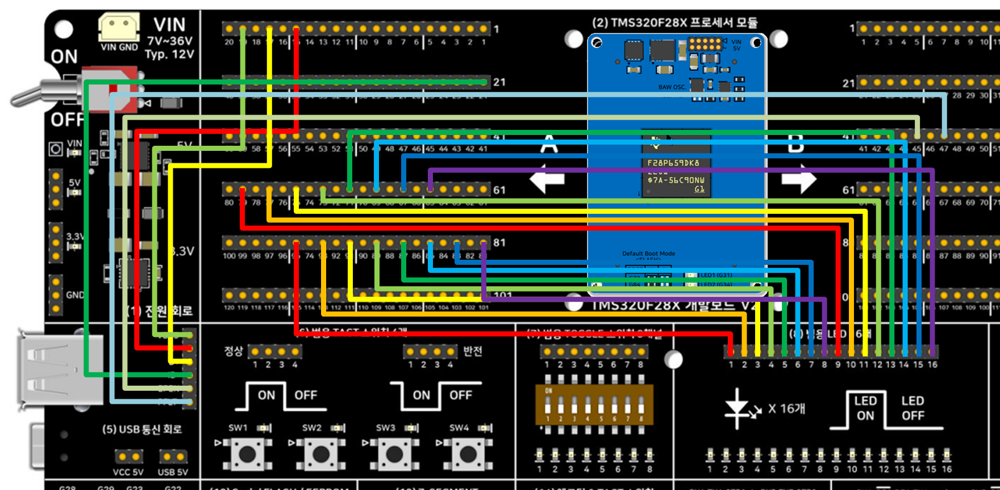

# USB 호스트 마우스 → LED16 좌우 이동 테스트 — DriverLib 버전 — TMS320F28P659DK8-Q1

TMS320F28P65x 개발보드 V2의 On-Chip USB(USB0)를 **호스트(Host) 모드**로 동작시켜 USB 마우스를
연결하고, 마우스의 좌우(X축) 움직임에 따라 개발보드 **(8) 범용 LED 16개** 블록의 점등 위치를
좌우로 이동시킵니다. 순수 DriverLib + TI USB Host Library(usblib)로 제작되었으며 SysConfig를
쓰지 않습니다.

## 요구 하드웨어
- SyncWorks TMS320F28X 개발보드 V2
- TMS320F28P650DK9 또는 TMS320F28P659DK8-Q1 모듈
- USB 마우스(HID 표준 마우스), 필요 시 USB 허브
- 점퍼 케이블 16개 (LED16 블록용)

## 배선

> **2026-09-28 정정**: 이전 버전은 "USB0DM/DP는 칩 전용 핀이라 점퍼가 필요 없다"고
> 적혀 있었는데 **틀린 내용이었습니다.** (5) USB 통신 회로는 매뉴얼 12장에 명시된 대로
> TMS320F2837x/F2838x용 ControlCARD 구성이라, F28P65x 모듈에서는 A/B Side 핀-헤더에서
> 점퍼로 직접 연결해야 합니다. `usb_hal.c`의 GPIO121/120(EPEN/PFLT)도 이 패키지
> (256ZEJ)에서 동작하지 않는 값이라 GPIO50/49로 고쳤습니다 — 이 수정은
> [Bitfield](../5_USB_HostMouse_Bitfield/)/[FreeRTOS](../5_USB_HostMouse_Freertos/)
> 버전에도 동일하게 반영했습니다.

| 신호 | 연결 |
|---|---|
| USB D- | **A Side 핀-헤더 15번**(GPIO42, USB0DM) → (5) 블록 "D-" 핀 |
| USB D+ | **A Side 핀-헤더 17번**(GPIO43, USB0DP) → (5) 블록 "D+" 핀 |
| USB VBUS | **A Side 핀-헤더 19번**(GPIO46) → (5) 블록 "VBUS" 핀 |
| USB ID | **A Side 핀-헤더 21번**(GPIO47) → (5) 블록 "ID" 핀 |
| USB EPEN | **B Side 핀-헤더 45번**(GPIO50) → (5) 블록 "EPEN" 핀 — 안 하면 VBUS 전원 스위치가 꺼져 마우스가 열거되지 않음 |
| USB PFLT | **B Side 핀-헤더 47번**(GPIO49) → (5) 블록 "PFLT" 핀 |
| LED | 개발보드 **A Side 핀-헤더 65, 67, 69, 71, 73, 75, 77, 79, 81, 83, 85, 87, 89, 91, 93, 95번**(홀수, GPIO0~GPIO15에 순서대로 1:1 대응)을 **(8) 범용 LED 16개** 블록 입력 16핀에 순서대로 연결 — `8_GP_LED16` 예제와 배선이 동일합니다. |

USB 마우스는 (5)번 회로 **Top면의 4핀 표준 USB 커넥터(Type-A)**에 직접 연결하거나
USB 허브를 통해 연결하세요.

> **참고**: EPEN/PFLT의 GPIO 번호(50/49)는 F28P65x 전용입니다. `usb_hal.c` 원본(TI
> 공식 C2000Ware 예제)은 F28P65x Control Card 기준 GPIO121/120을 쓰는데, 이 패키지
> (256ZEJ)에서 GPIO121은 존재하지 않는 예약 핀이라 실제로는 다른 GPIO(50/49)가
> 옵니다 — 자세한 근거는 `usb_hal.c`의 `USBGPIOEnable()` 함수 주석 참고.

### 실제 배선 사진

위 표의 신호별 연결(USB D-/D+/VBUS/ID/EPEN/PFLT, LED16)을 실제로 점퍼선으로 구현한
모습입니다. 비트필드/FreeRTOS 버전도 배선이 100% 동일합니다.

## 소프트웨어 구성
- CCS: 21.x (Theia 기반)
- **SysConfig 미사용** — `products="C2000WARE"`만 사용
- C2000Ware: 26.00.00.00 — `device.h`/`device.c`/`driverlib.h`/driverlib 헤더 전체/
  `driverlib.lib`에 더해, **USB Host Library(usblib) 헤더 전체(`usb/include/`)와
  `usblib.lib`**를 이 폴더 안에 전부 복사해 두어 C2000Ware 설치 경로에 의존하지 않습니다.
- Code Generation Tools: 22.6.3.LTS
- 컴파일러 정의 `--define=ccs_c2k` 필수(`usblib.h`가 TI CCS/C2000 컴파일러임을 식별하는
  매크로) — `.projectspec`에 이미 반영되어 있습니다.

## 동작 방식

TI의 공식 레퍼런스 예제 `driverlib/f28p65x/examples/c28x/usb/usb_ex5_host_mouse.c`를
기반으로 이식했습니다. 원본은 SysConfig가 생성하는 `Board_init()`/`C2000Ware_libraries_init()`
안에서 USB 초기화를 대신 처리해주는데, 이 예제는 SysConfig 없이 그 안의 실제 동작을
`main()`에서 직접 호출합니다.

1. **USB 60MHz 클럭 (`SysCtl_setAuxClock`)**: F28P65x의 USB 컨트롤러는 SYSCLK가 아니라
   별도의 AUXPLL 60MHz 클럭이 필요합니다. `usb_hal.h`의 `DEVICE_AUXSETCLOCK_CONFIG_USB`
   매크로가 보드의 25MHz BAW 오실레이터 기준으로 AUXPLLCLK 120MHz → /2 → 60MHz를
   만듭니다(25MHz × 48 ÷ (2×5) = 120MHz).
2. **USB 핀 활성화 (`USBGPIOEnable`, `usb_hal.c`)**: GPIO42/43(DM/DP)을 아날로그 모드로,
   GPIO46(VBUS 감지)/GPIO47(ID)을 입력으로 설정합니다.
3. **USB 인터럽트 연결**: `Interrupt_register(INT_USBA, &usbHostISR)` — ISR은
   `USB0HostIntHandler()`를 호출한 뒤 PIE 그룹9를 Acknowledge합니다.
4. **호스트 스택 초기화**:
   - `USBStackModeSet(0, eUSBModeForceHost, ModeCallback)` — OTG 협상 없이 호스트로 고정.
   - `USBHCDRegisterDrivers()` — HID 클래스 드라이버 + 일반 이벤트 드라이버 등록.
   - `USBHMouseOpen(MouseCallback, ...)` — 마우스 클래스 인스턴스 예약(마우스가 아직
     없어도 됨).
   - `USBHCDPowerConfigInit()` / `USBHCDInit()` — VBUS 전원 설정 및 2ms 폴링 주기로
     호스트 컨트롤러 초기화.
5. **메인 루프**: `USBHCDMain()`을 계속 호출해 열거(enumeration)와 클래스 드라이버를
   폴링합니다. `USBHCDEvents()` 콜백이 HID 마우스 연결을 감지하면 `STATE_MOUSE_INIT`으로
   전이시키고, 메인 루프가 `USBHMouseInit()`을 호출합니다(콜백 컨텍스트에서는 호출할 수
   없음).
6. **마우스 → LED 매핑 (`MouseCallback`)**: `USBH_EVENT_HID_MS_X` 이벤트에서 마우스가
   보고하는 8비트 부호있는 상대 이동량을 `motionAccumX`에 누적하다가
   `MOUSE_STEP_THRESHOLD`(기본 12카운트)를 넘을 때마다 `ledIndex`를 한 칸씩 좌/우로
   옮기고 `updateLedDisplay()`로 GPIO를 갱신합니다. 양쪽 끝(0, 15)에서는 더 이상
   넘어가지 않고 멈춥니다. Y축 이동과 버튼 클릭은 `mouseCursorX`/`mouseButtons`에는
   반영되지 않는 Y, 버튼은 별도 변수로만 노출됩니다(LED 제어에는 X축만 사용).

## 정상 동작 확인

CCS Expressions 창에 아래 변수를 등록하고 Continuous Refresh를 켠 뒤 USB 마우스를 연결해
보세요:

- `usbHostState` — 0=미연결, 1=마우스 초기화 중, 2=마우스 연결됨, 3=미지원 장치, 4=전원 오류.
  마우스를 꽂으면 0 → 1 → 2로 바뀌어야 합니다.
- `ledIndex` — 0~15. 마우스를 좌우로 움직이면 값이 따라 바뀌고, 실제 보드에서도 점등된
  LED가 좌우로 이동하는 것이 보여야 합니다.
- `mouseCursorX` — 누적 X 이동량(디버깅용, 범위 제한 없음).
- `mouseButtons` — bit0=좌클릭, bit1=우클릭, bit2=휠클릭.

`MOUSE_STEP_THRESHOLD`(소스 상단 `#define`)를 줄이면 더 예민하게, 늘리면 더 둔감하게
반응하도록 튜닝할 수 있습니다.

## 메모리 사용량 (CPU1_RAM 빌드 실측, 2026-09-28)

`C:\Users\vosam\workspace_ccstheia\5_USB_HostMouse_*\CPU1_RAM\*.map`을 실제로 빌드해
링커 맵에서 집계한 값입니다(플래시가 아닌 RAM 로드 구성 기준, 링커 cmd가 매핑하는
GPIO/PIE 등 레지스터 윈도우는 제외):

| 영역 | 비트필드 | **DriverLib(이 폴더)** | FreeRTOS |
|---|---|---|---|
| 코드(RAMD0+RAMD1) | 13,323 B | 16,384 B | 16,384 B |
| 데이터/BSS/CONST(RAMLSx) | 2,429 B | 3,518 B | 6,604 B |
| 스택(RAMM1) | 1,016 B | 1,016 B | 1,016 B |
| 기타(RAMM0+BEGIN) | 44 B | 40 B | 50 B |
| **합계** | **16,812 B (16.4 KB)** | **20,958 B (20.5 KB)** | **24,054 B (23.5 KB)** |

비트필드 버전보다 약 4KB 큰 이유는 DriverLib 함수 호출(인자 검증, 레이어 추상화)의
코드 오버헤드입니다. FreeRTOS 버전은 여기에 커널 자체 코드/데이터가 더해져 가장 큽니다.

## Import → Build → Flash → Run
1. CCS에서 `CCS/5_USB_HostMouse_Driverlib.projectspec`를 Import
2. Build (CPU1_RAM 또는 CPU1_FLASH)
3. Debug 연결 후 Flash/Run
4. `.ccxml`은 `TMS320F28P650DK9.ccxml`을 그대로 사용 — F28P659DK8-Q1 최초 연결 시 정상
   인식 확인 필요

## 세 가지 버전 비교
같은 USB 호스트 마우스 → LED16 좌우 이동을 세 가지 방식으로 구현해 비교합니다.

| 버전 | 폴더 | 핵심 차이 |
|---|---|---|
| **DriverLib(이 폴더)** | 5_USB_HostMouse_Driverlib | TI 표준 HAL 함수 호출 |
| 비트필드 | [5_USB_HostMouse_Bitfield](../5_USB_HostMouse_Bitfield/) | 레지스터 구조체 직접 조작(USB 클럭/GPIO/인터럽트만 해당 — usblib API 자체는 동일) |
| FreeRTOS | [5_USB_HostMouse_Freertos](../5_USB_HostMouse_Freertos/) | DriverLib + 태스크 스케줄링, 정적 할당 |

## 관련 링크
- 상품 페이지: https://tms320f28x.co.kr/goods/goods_view.php?goodsNo=200903127
- 게시판 글: (게시 후 URL 추가 예정)
- 유튜브 영상: (게시 후 URL 추가 예정)
