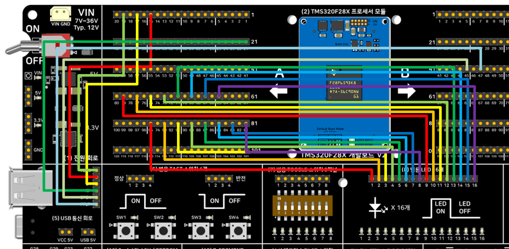

# USB 호스트 마우스 → LED16 좌우 이동 테스트 — FreeRTOS 버전 — TMS320F28P659DK8-Q1

TMS320F28P65x 개발보드 V2의 On-Chip USB(USB0)를 호스트 모드로 동작시켜 USB 마우스를
연결하고, 마우스의 좌우(X축) 움직임에 따라 개발보드 **(8) 범용 LED 16개** 블록의 점등
위치를 좌우로 이동시킵니다. FreeRTOS 태스크(정적 할당, 힙 미사용) + DriverLib +
TI USB Host Library(usblib)로 제작되었습니다.

## 이 버전의 핵심 — 태스크 1개로 베어메탈 루프를 그대로 감쌈

1. **태스크: `UsbMouseTask` (우선순위: `tskIDLE_PRIORITY + 1`)**
   - `USBHCDMain()`을 계속 호출해 USB 호스트 스택을 폴링하고 마우스 상태 머신을
     처리합니다. `vTaskDelay` 없이 계속 도는 이유는 USB 폴링이 가능한 자주 실행돼야
     하기 때문입니다 — 이 프로젝트의 유일한 태스크이므로 DriverLib/비트필드 버전의
     `while(1)` 루프와 실질적으로 동일하게 동작하며, FreeRTOS 스케줄러/틱 인터럽트가
     배경에서 함께 돌 뿐입니다.
2. **완전한 정적 메모리 할당 (Zero Heap)**:
   - `configSUPPORT_DYNAMIC_ALLOCATION=0`, `configSUPPORT_STATIC_ALLOCATION=1` 설정으로
     힙 메모리를 일체 사용하지 않습니다.
   - 태스크 스택(`STACK_SIZE = 512`워드, USB 스택 폴링을 고려해 여유 있게 설정)과 TCB,
     Idle 태스크 메모리까지 모두 정적 전역 변수로 할당하여 `.freertosStaticStack` 섹션에
     안전하게 배치했습니다.

## 요구 하드웨어 / 배선 (Bitfield, DriverLib 예제와 100% 동일)

> **2026-09-28 정정**: 이전 버전은 "USB0DM/DP는 칩 전용 핀이라 점퍼가 필요 없다"고
> 적혀 있었는데 **틀린 내용이었습니다.** (5) USB 통신 회로는 매뉴얼 12장에 명시된 대로
> TMS320F2837x/F2838x용 ControlCARD 구성이라, F28P65x 모듈에서는 A/B Side 핀-헤더에서
> 점퍼로 직접 연결해야 합니다. `usb_hal.c`의 GPIO121/120(EPEN/PFLT)도 이 패키지
> (256ZEJ)에서 동작하지 않는 값이라 GPIO50/49로 고쳤습니다 — 이 수정은
> [Bitfield](../5_USB_HostMouse_Bitfield/)/[DriverLib](../5_USB_HostMouse_Driverlib/)
> 버전에도 동일하게 반영했습니다.

| 신호 | 연결 |
|---|---|
| USB D- | **A Side 핀-헤더 15번**(GPIO42, USB0DM) → (5) 블록 "D-" 핀 |
| USB D+ | **A Side 핀-헤더 17번**(GPIO43, USB0DP) → (5) 블록 "D+" 핀 |
| USB VBUS | **A Side 핀-헤더 19번**(GPIO46) → (5) 블록 "VBUS" 핀 |
| USB ID | **A Side 핀-헤더 21번**(GPIO47) → (5) 블록 "ID" 핀 |
| USB EPEN | **B Side 핀-헤더 45번**(GPIO50) → (5) 블록 "EPEN" 핀 — 안 하면 VBUS 전원 스위치가 꺼져 마우스가 열거되지 않음 |
| USB PFLT | **B Side 핀-헤더 47번**(GPIO49) → (5) 블록 "PFLT" 핀 |
| LED | 개발보드 **A Side 핀-헤더 65, 67, 69, 71, 73, 75, 77, 79, 81, 83, 85, 87, 89, 91, 93, 95번**(홀수, GPIO0~GPIO15에 순서대로 1:1 대응)을 **(8) 범용 LED 16개** 블록 입력 16핀에 순서대로 연결. |

USB 마우스는 (5)번 회로 **Top면의 4핀 표준 USB 커넥터(Type-A)**에 직접 연결하거나
USB 허브를 통해 연결하세요.

### 실제 배선 사진

위 표의 신호별 연결(USB D-/D+/VBUS/ID/EPEN/PFLT, LED16)을 실제로 점퍼선으로 구현한
모습입니다. 비트필드/DriverLib 버전도 배선이 100% 동일합니다.

## 소프트웨어 구성
- CCS: 21.x (Theia 기반)
- **SysConfig 미사용** — `products="C2000WARE"`만 사용
- C2000Ware: 26.00.00.00 driverlib(로컬 복사) + USB Host Library(usblib) 헤더/라이브러리
- **FreeRTOS 커널 소스 전체를 `FreeRTOS/` 폴더에 로컬 복사** (TI kernel/FreeRTOS 배포본 기준)
- Code Generation Tools: 22.6.3.LTS
- 컴파일러 정의 `--define=ccs_c2k` 필수(`usblib.h`가 TI CCS/C2000 컴파일러임을 식별하는
  매크로) — `.projectspec`에 이미 반영되어 있습니다.

## 메모리 사용량 (CPU1_RAM 빌드 실측, 2026-09-28)

`C:\Users\vosam\workspace_ccstheia\5_USB_HostMouse_*\CPU1_RAM\*.map`을 실제로 빌드해
링커 맵에서 집계한 값입니다(플래시가 아닌 RAM 로드 구성 기준, 링커 cmd가 매핑하는
GPIO/PIE 등 레지스터 윈도우는 제외):

| 영역 | 비트필드 | DriverLib | **FreeRTOS(이 폴더)** |
|---|---|---|---|
| 코드(RAMD0+RAMD1) | 13,323 B | 16,384 B | 16,384 B |
| 데이터/BSS/CONST(RAMLSx) | 2,429 B | 3,518 B | 6,604 B |
| 스택(RAMM1) | 1,016 B | 1,016 B | 1,016 B |
| 기타(RAMM0+BEGIN) | 44 B | 40 B | 50 B |
| **합계** | **16,812 B (16.4 KB)** | **20,958 B (20.5 KB)** | **24,054 B (23.5 KB)** |

DriverLib 버전보다 약 3KB 큰 이유는 FreeRTOS 커널 자체 코드/데이터(태스크 스택,
TCB, 스케줄러 틱 처리 등, 전부 정적 할당)가 더해지기 때문입니다 — 힙(`.freertosHeap`)은
쓰지 않으므로 이 차이는 전부 `.data`/`.bss`/`.const` 쪽 코드·데이터 증가분입니다.

## Import → Build → Flash → Run
1. CCS에서 `CCS/5_USB_HostMouse_Freertos.projectspec`를 Import
2. Build (CPU1_RAM 또는 CPU1_FLASH) — FreeRTOS 전용 링커 cmd(`28p65x_freertos_*_lnk_cpu1.cmd`) 사용.
3. Debug 연결 후 Flash/Run

## 정상 동작 확인

CCS Expressions 창에 아래 변수를 등록하고 Continuous Refresh를 켠 뒤 USB 마우스를 연결해
보세요:

- `usbHostState` — 0=미연결, 1=마우스 초기화 중, 2=마우스 연결됨, 3=미지원 장치, 4=전원 오류
- `ledIndex` — 0~15. 마우스를 좌우로 움직이면 값이 따라 바뀌고, 실제 보드에서도 점등된 LED가 좌우로 이동해야 합니다.
- `mouseCursorX` — 누적 X 이동량(디버깅용)
- `mouseButtons` — bit0=좌클릭, bit1=우클릭, bit2=휠클릭

## 세 가지 버전 비교
같은 USB 호스트 마우스 → LED16 좌우 이동을 세 가지 방식으로 구현해 비교합니다.

| 버전 | 폴더 | 핵심 차이 |
|---|---|---|
| DriverLib | [5_USB_HostMouse_Driverlib](../5_USB_HostMouse_Driverlib/) | TI 표준 HAL 함수 호출, 베어메탈 while(1) 루프 |
| 비트필드 | [5_USB_HostMouse_Bitfield](../5_USB_HostMouse_Bitfield/) | 애플리케이션 코드는 레지스터 구조체 직접 조작 |
| **FreeRTOS(이 폴더)** | 5_USB_HostMouse_Freertos | DriverLib + FreeRTOS 태스크 스케줄링(정적 할당, UsbMouseTask 1개) |

## 관련 링크
- 상품 페이지: https://tms320f28x.co.kr/goods/goods_view.php?goodsNo=200903127
- 게시판 글: https://tms320f28x.co.kr/board/view.php?bdId=tms320f28xevmv2&sno=110
- 유튜브 영상: (게시 후 URL 추가 예정)
