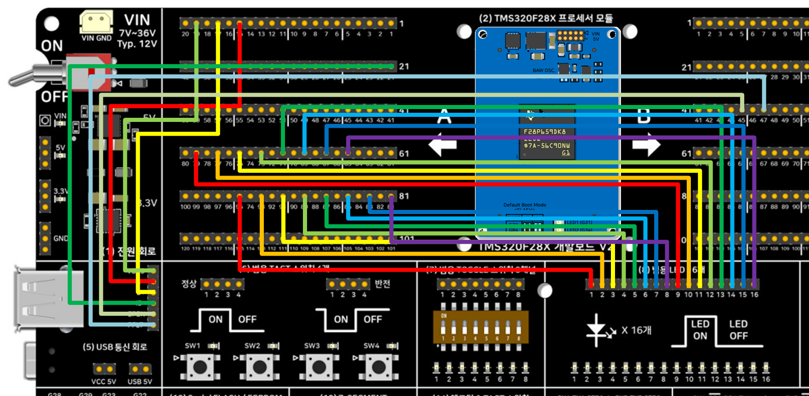

# TMS320F28X 개발보드 V2 — F28P65x USB 호스트 마우스 예제

[TMS320F28X 범용 개발보드 V2](https://tms320f28x.co.kr/goods/goods_view.php?goodsNo=200903127)의
회로블록 **(5) USB 통신 회로**를 F28P65x 모듈의 On-Chip USB(USB0) **호스트(Host) 모드**로
구동하는 예제입니다. USB 마우스를 연결해 좌우(X축) 움직임을 읽어, 개발보드
**(8) 범용 LED 16개** 블록의 점등 위치를 마우스를 따라 좌우로 이동시킵니다. 같은 동작을
세 가지 방식으로 각각 구현해서 코드량·메모리 사용량을 비교할 수 있게 만들었습니다.

## 포함된 프로젝트

| 프로젝트 | 설명 |
|---|---|
| [5_USB_HostMouse_Bitfield](5_USB_HostMouse_Bitfield/) | 레지스터 비트필드 직접 제어(USB 클럭/GPIO/인터럽트만 해당 — usblib API 자체는 동일) |
| [5_USB_HostMouse_Driverlib](5_USB_HostMouse_Driverlib/) | TI DriverLib 사용 |
| [5_USB_HostMouse_Freertos](5_USB_HostMouse_Freertos/) | FreeRTOS 태스크로 구현(정적 할당, 힙 미사용) |

각 폴더는 자기완결형(self-contained) CCS 프로젝트입니다 — 폴더 하나만 받아도 C2000Ware/
DriverLib/USB Host Library(usblib) 등 필요한 파일이 전부 로컬에 포함되어 있어
Import → Build가 됩니다.

## 배선

USB 마우스 신호(D-/D+/VBUS/ID/EPEN/PFLT)와 LED16 블록을 A/B-Side 핀-헤더로 점퍼 연결합니다.

| 신호 | 연결 |
|---|---|
| USB D- | A Side 핀-헤더 15번(GPIO42, USB0DM) → (5) 블록 "D-" |
| USB D+ | A Side 핀-헤더 17번(GPIO43, USB0DP) → (5) 블록 "D+" |
| USB VBUS | A Side 핀-헤더 19번(GPIO46) → (5) 블록 "VBUS" |
| USB ID | A Side 핀-헤더 21번(GPIO47) → (5) 블록 "ID" |
| USB EPEN | B Side 핀-헤더 45번(GPIO50) → (5) 블록 "EPEN" — 안 하면 VBUS 전원 스위치가 꺼져 마우스가 열거되지 않음 |
| USB PFLT | B Side 핀-헤더 47번(GPIO49) → (5) 블록 "PFLT" |
| LED | A Side 핀-헤더 65~95번(홀수, GPIO0~15에 순서대로 1:1 대응) → (8) 범용 LED 16개 블록 |

EPEN/PFLT의 GPIO 번호(50/49)는 F28P65x 전용입니다 — 자세한 배경은 각 프로젝트
README의 "배선" 절을 참고하세요.

## 메모리 사용량 비교 (CPU1_RAM 빌드 실측)

| 영역 | Bitfield | DriverLib | FreeRTOS |
|---|---|---|---|
| 코드(RAMD0+RAMD1) | 13,323 B | 16,384 B | 16,384 B |
| 데이터/BSS/CONST | 2,429 B | 3,518 B | 6,604 B |
| 스택 | 1,016 B | 1,016 B | 1,016 B |
| 기타 | 44 B | 40 B | 50 B |
| **합계** | **16,812 B (16.4 KB)** | **20,958 B (20.5 KB)** | **24,054 B (23.5 KB)** |

세부 원인 분석은 각 프로젝트 README의 "메모리 사용량" 절을 참고하세요.

## 프로세서 모듈

- [TMS320F28P650DK9 모듈(산업용)](https://tms320f28x.co.kr/goods/goods_view.php?goodsNo=200903200)
- [TMS320F28P659DK8-Q1 모듈(차량 전장용)](https://tms320f28x.co.kr/goods/goods_view.php?goodsNo=200903201)

## 개발 환경

CCS 21.x(Theia 기반) / TI CGT 22.6.3.LTS / C2000Ware 26.00.00.00

## Import 방법 (zip 직접 import도 지원)

압축을 미리 풀어서 "Select search-directory"로 지정하거나, GitHub에서 받은 zip 파일을
그대로 CCS의 "Select archive file"로 지정해도 됩니다 — 둘 다 정상 동작합니다.
